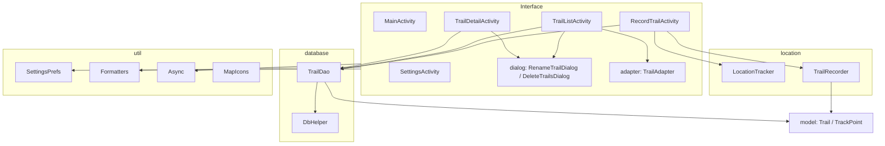
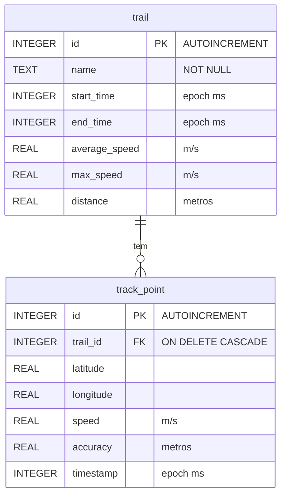
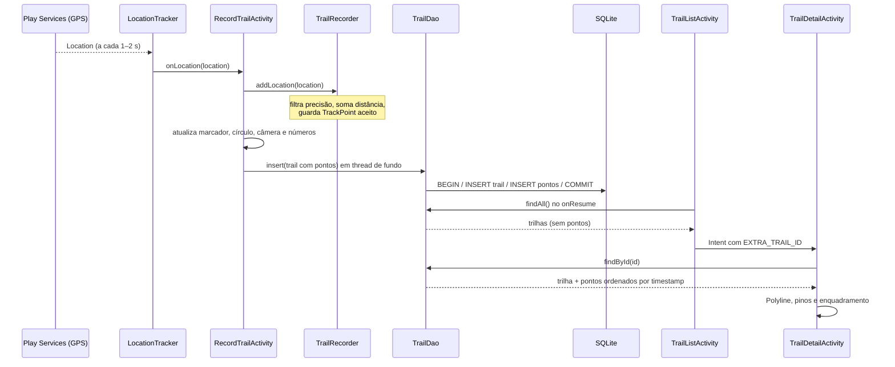

# Arquitetura

Visão geral de como o TrilhaApp é organizado: camadas, banco de dados e o caminho de um ponto de GPS
desde o sensor até o mapa da tela Visualizar.

---

## 1. Camadas e pacotes

| Pacote | Responsabilidade | Não pode |
|---|---|---|
| `activities` | Montar a tela, reagir a cliques e ao ciclo de vida, chamar as outras camadas | Ter SQL ou cálculo de GPS |
| `adapter` | Ligar cada `Trail` a um cartão da lista e repassar os cliques | Decidir o que o clique faz |
| `dialog` | Coletar e validar a escolha do usuário (novo nome, modo de apagar) | Chamar o DAO |
| `location` | GPS (`LocationTracker`) e estado da gravação (`TrailRecorder`) | Mexer em View |
| `database` | Esquema (`DbHelper`) e operações (`TrailDao`) | Mexer em View |
| `model` | Dados: `Trail` (mutável, tem id e nome editável) e `TrackPoint` (record imutável) | — |
| `util` | Preferências, formatação, thread de fundo, ícones do mapa | — |

---

## 2. Banco de dados

- **2 tabelas relacionadas (1:N)**: uma trilha tem muitos pontos.
- **`ON DELETE CASCADE`** + `setForeignKeyConstraintsEnabled(true)` no `onConfigure`: apagar a trilha apaga os pontos.
  O SQLite vem com chaves estrangeiras **desligadas**; sem essa linha o cascade seria ignorado.
- **Índice `idx_point_trail`** em `track_point(trail_id)`: os pontos são sempre buscados por trilha.
- **Datas em milissegundos (`INTEGER`)**: o SQLite não tem tipo data; `long` em ms é o formato que o Android já
  entrega, ordena com `ORDER BY` e funciona com `BETWEEN` no "apagar por intervalo".
- **Unidades SI no banco** (m, m/s, ms). Conversão para km, km/h e hh:mm:ss só na tela, em `Formatters`.
- **Inserção em transação**: trilha + centenas de pontos são gravados de uma vez; se algo falhar, nada fica pela metade.
- **Parâmetros `?`** em todas as consultas (`selectionArgs`), nunca concatenação: evita SQL injection.

---

## 3. Fluxo de ponta a ponta: GPS → memória → banco → lista → mapa

1. **GPS → memória**: o `LocationTracker` entrega cada `Location`; o `TrailRecorder` decide o que entra na trilha.
2. **Memória → banco**: ao finalizar, a Activity monta um `Trail` com a lista de `TrackPoint` e o `TrailDao` grava tudo
   numa transação, fora da UI thread (`Async`).
3. **Banco → lista**: `findAll()` traz só os resumos (sem pontos), da mais recente para a mais antiga.
4. **Lista → mapa**: só o **id** viaja no `Intent`; a tela Visualizar carrega a trilha completa do banco.

---

## 4. Decisões de projeto

| Decisão | Por quê |
|---|---|
| Java + SQLite puro (`SQLiteOpenHelper`), sem Room | O enunciado pede Java e SQLite; o SQL fica visível e explicável |
| View Binding em vez de `findViewById` | Classe gerada por layout com cada view já tipada: id errado não compila, sem cast e sem `null` escondido |
| minSdk 28 | As bibliotecas atuais do Google Play Services não suportam o 17 do enunciado |
| `TrailRecorder` dentro de um `ViewModel` | Sobrevive à rotação de tela sem salvar centenas de pontos no `Bundle` |
| GPS liga no `onResume` e desliga no `onPause` | Bateria e privacidade; consequência: gravação não continua em segundo plano (exigiria Foreground Service) |
| `Async` com uma única thread de fundo | Banco fora da UI thread e gravações em ordem, sem duas transações ao mesmo tempo |
| Diálogos não chamam o DAO | Mantém a regra "View não sabe de banco"; a Activity decide e salva |
| `TrackPoint` como `record` | Uma leitura de GPS não muda depois de lida; o `trail_id` é responsabilidade do DAO |
| Chave do Maps no `local.properties` + placeholder no manifest | Credencial fora do Git |
| Tema sempre claro | O protótipo só define o tema claro; mapas e cartões foram desenhados para ele |
