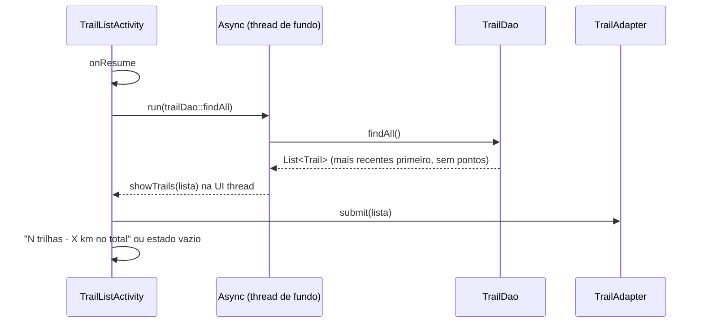
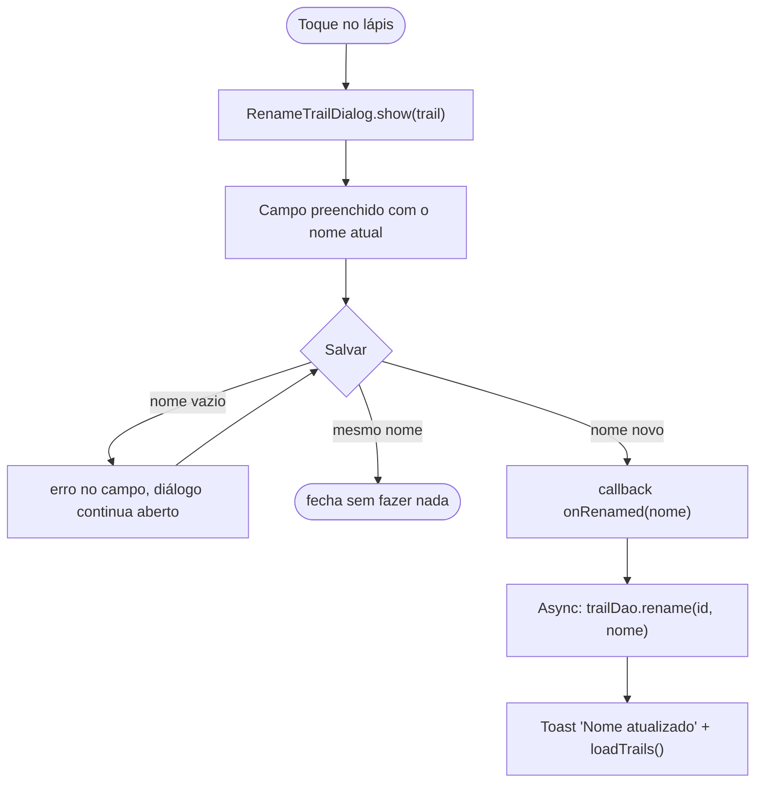
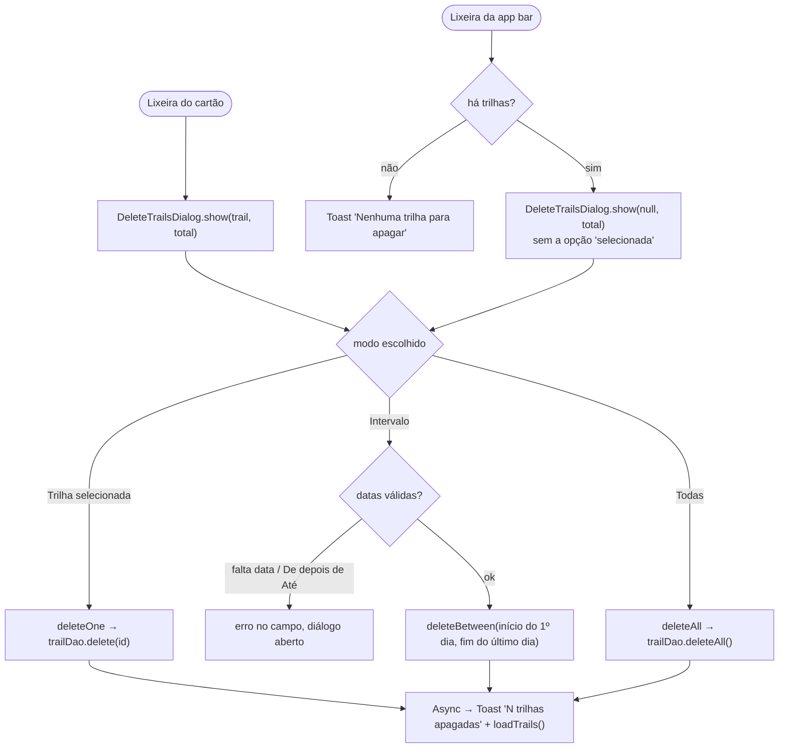

# Tela Consultar Trilhas

A tela `TrailListActivity` lista todas as trilhas salvas e permite **abrir**, **renomear** e **apagar**
(uma, por intervalo de datas ou todas).

---

## 1. Arquivos envolvidos

| Arquivo | Papel |
|---|---|
| `activities/TrailListActivity.java` | Carrega as trilhas, mostra totais / estado vazio e decide o que cada clique faz |
| `adapter/TrailAdapter.java` | Liga cada `Trail` a um cartão e repassa os cliques pela interface `Listener` |
| `dialog/RenameTrailDialog.java` | Coleta e valida o novo nome (também usado na tela Visualizar) |
| `dialog/DeleteTrailsDialog.java` | Coleta o modo de apagar e valida o intervalo |
| `database/TrailDao.java` | `findAll`, `rename`, `delete`, `deleteBetween`, `deleteAll` |
| `res/layout/activity_trail_list.xml` / `item_trail.xml` | Tela e cartão |
| `res/layout/dialog_rename_trail.xml` / `dialog_delete_trails.xml` | Corpo dos diálogos |

---

## 2. Carregar a lista

- **`onResume`, não `onCreate`**: ao voltar da gravação, da visualização (onde o nome pode mudar) ou de um diálogo,
  a lista é recarregada.
- **`findAll` não traz os pontos**: a lista só mostra o resumo; carregar milhares de pontos seria desperdício.
- **Texto com plural** (`getQuantityString`): "1 trilha" / "5 trilhas".

### `TrailAdapter`

| Membro | O que faz |
|---|---|
| `Listener` | `onOpen`, `onRename`, `onDelete`: implementados pela Activity |
| `submit(lista)` | Troca a lista e redesenha |
| `onCreateViewHolder` | Infla `item_trail.xml` com `ItemTrailBinding.inflate` |
| `onBindViewHolder` / `TrailViewHolder.bind` | Nome, data/hora, distância e duração formatados; liga os 3 cliques |

O **ViewHolder** guarda o `ItemTrailBinding` do cartão (View Binding), criado uma vez no `onCreateViewHolder` e
reaproveitado quando o cartão volta na rolagem. O adapter **não decide** o que um clique faz: só avisa a Activity.
Assim ele não depende de banco nem de navegação.

---

## 3. Renomear

O listener do botão Salvar é trocado **depois** do `show()`: o botão padrão do `AlertDialog` sempre fecha o diálogo,
e assim dá para mantê-lo aberto quando o nome está vazio.

---

## 4. Apagar

- **Intervalo por dias inteiros** no fuso do celular: `De` vira 00:00:00.000 e `Até` vira 23:59:59.999. Sem isso, uma
  trilha feita à tarde no último dia ficaria de fora. O SQL é `start_time BETWEEN ? AND ?` (inclui os dois limites).
- **Os pontos vão junto** pelo `ON DELETE CASCADE`: os métodos de apagar só mexem na tabela `trail`.
- **`deleteAll` usa `whereClause = "1"`**: é a forma documentada de o `delete()` devolver quantas linhas apagou.
- Os diálogos **não chamam o DAO**: devolvem a escolha por callback, e a Activity executa. A regra "View não sabe de
  banco" vale também para eles.

### `DeleteTrailsDialog`

| Método | O que faz |
|---|---|
| `show(context, selected, total, callbacks)` | Abre o diálogo; com `selected == null` esconde a opção "Trilha selecionada" |
| `select(modo)` / `setChecked` | Marca o cartão + radio do modo e mostra os campos de data só no modo intervalo |
| `pickDate(isFrom)` | `DatePickerDialog` (meses começam em 0 nele e em 1 no `LocalDate`) |
| `confirm` / `confirmRange` | Chama o callback certo; devolve `false` para manter o diálogo aberto se o intervalo for inválido |

---

## 5. Abrir a trilha

`onOpen` cria um `Intent` para `TrailDetailActivity` com `EXTRA_TRAIL_ID`. **Só o id viaja**: a tela de destino
carrega a trilha completa do banco (um objeto com milhares de pontos não deve ir dentro de um `Intent`).
O FAB "Nova trilha" abre a `RecordTrailActivity`.
