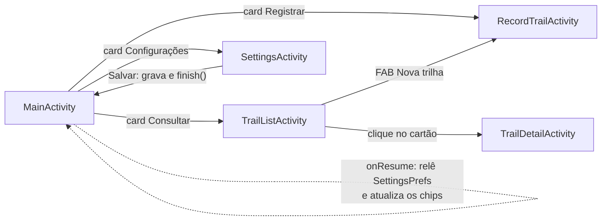
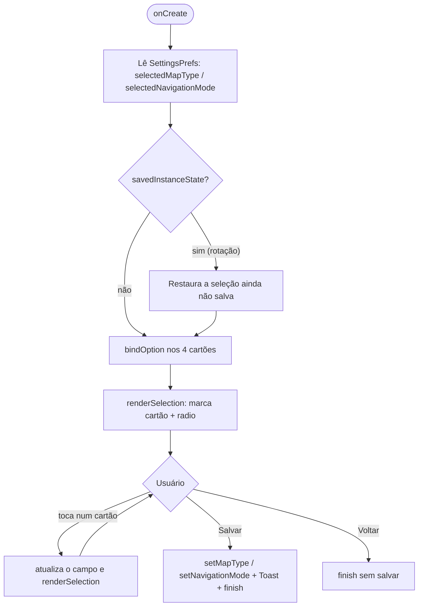

# Telas Principal e Configuração

A tela **Principal** (`MainActivity`) é o menu do app e mostra a configuração atual.
A tela **Configuração** (`SettingsActivity`) escolhe o tipo de mapa e a forma de navegação, guardados com
`SharedPreferences` pela classe `SettingsPrefs` e válidos para o app todo.

---

## 1. Fluxo entre as telas

---

## 2. `SettingsPrefs` (pacote `util`)

Centraliza o acesso ao `SharedPreferences` para não espalhar chaves "mágicas" pelo código.

| Membro | O que faz |
|---|---|
| `MapType { VECTOR, SATELLITE }` | Tipo de mapa; cada valor guarda o texto que o representa (`labelResId`) |
| `NavigationMode { NORTH_UP, COURSE_UP }` | Forma de navegação; também com `labelResId` |
| `getMapType()` / `setMapType()` | Lê / grava o tipo de mapa (padrão: vetorial) |
| `getNavigationMode()` / `setNavigationMode()` | Lê / grava a navegação (padrão: North Up) |
| `readEnum(...)` | Lê o enum salvo pelo **nome**; valor desconhecido volta para o padrão |

Decisões:

- **Enum salvo pelo `name()`**, não pelo `ordinal()`: reordenar as constantes não troca a configuração do usuário.
- **`try/catch` no `Enum.valueOf`**: se uma constante for renomeada numa versão futura, o app não quebra; usa o padrão.
- **`apply()`** em vez de `commit()`: grava em segundo plano, sem travar a UI thread.
- **`getApplicationContext()`**: o helper nunca prende uma Activity na memória.
- **`labelResId` no enum**: qualquer tela mostra o texto certo com `getString(mapType.labelResId)`, sem `switch`.

---

## 3. `MainActivity`

| Método | O que faz |
|---|---|
| `onCreate` | Edge-to-edge, insets do cabeçalho verde e configuração dos 3 cartões do menu |
| `onResume` | Chama `updateCurrentSettings()` |
| `updateCurrentSettings` | Lê `SettingsPrefs` e escreve "Mapa vetorial" / "North Up" nos chips do rodapé |
| `setupMenuCards` / `setupCard` | Preenche ícone, título e subtítulo de cada cartão e liga o clique à Activity de destino |
| `setupWindowInsets` | Cabeçalho verde atrás da barra de status; conteúdo afastado das barras do sistema |

**Por que `onResume` e não `onCreate` para os chips?** Ao salvar na Configuração e dar `finish()`, a `MainActivity`
volta para a frente **sem ser recriada**: `onCreate` não roda de novo, mas `onResume` sim.

---

## 4. `SettingsActivity`

| Método | O que faz |
|---|---|
| `bindOption` | Preenche miniatura, título, descrição e selo "Padrão" de um cartão (mesmo layout incluído 4 vezes) |
| `selectMapType` / `selectNavigationMode` | Troca a seleção em memória; **não grava** (só o botão Salvar grava) |
| `renderSelection` / `setOptionChecked` | Marca o cartão **e** o radio (o `setChecked` do cartão não propaga para o radio) |
| `onSaveInstanceState` | Guarda a seleção não salva para sobreviver à rotação |
| `setupSaveButton` | Grava, mostra "Configurações salvas" e fecha |
