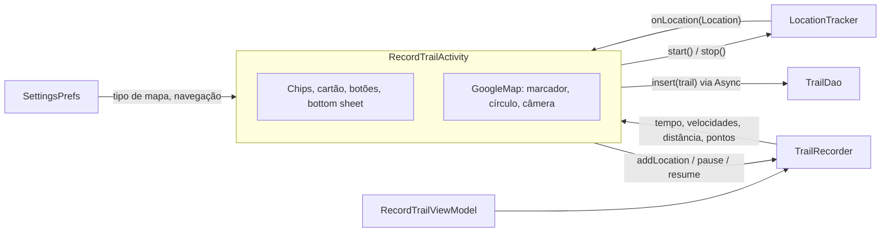
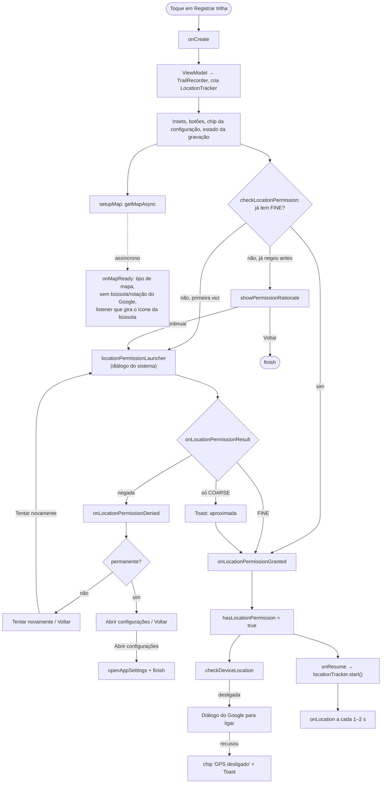
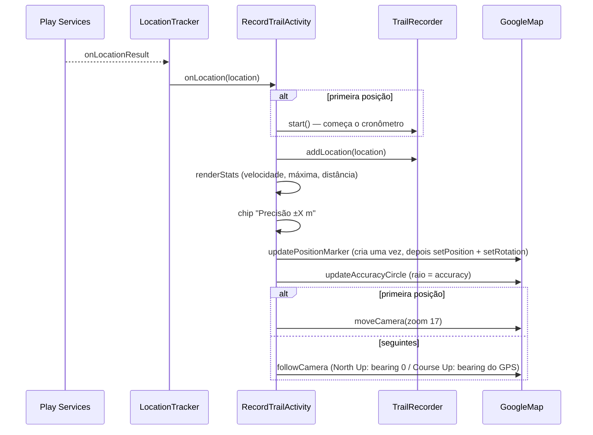
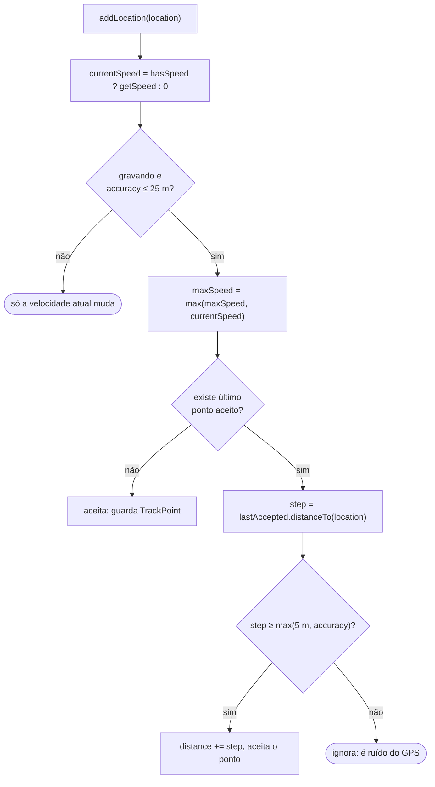
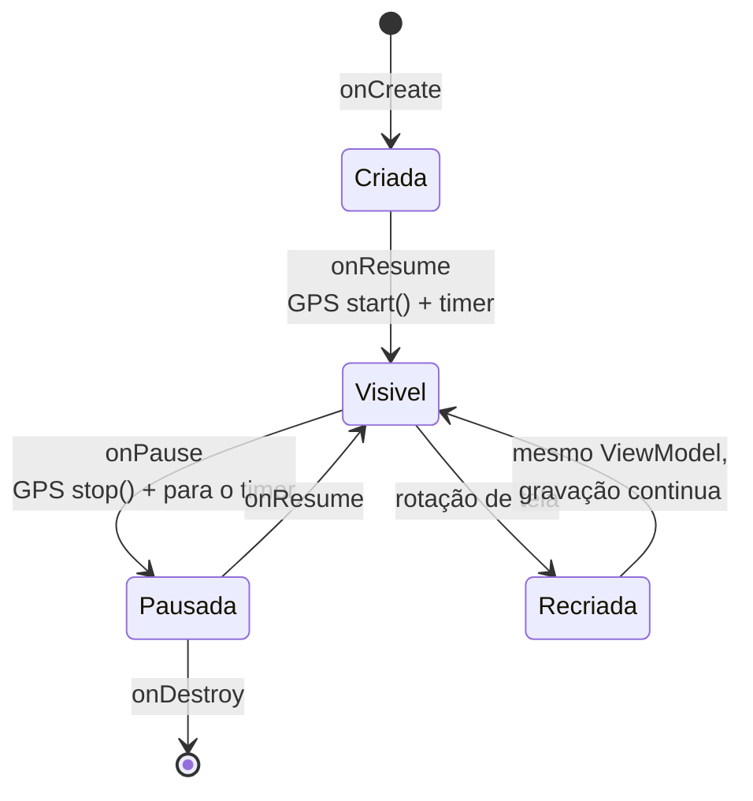
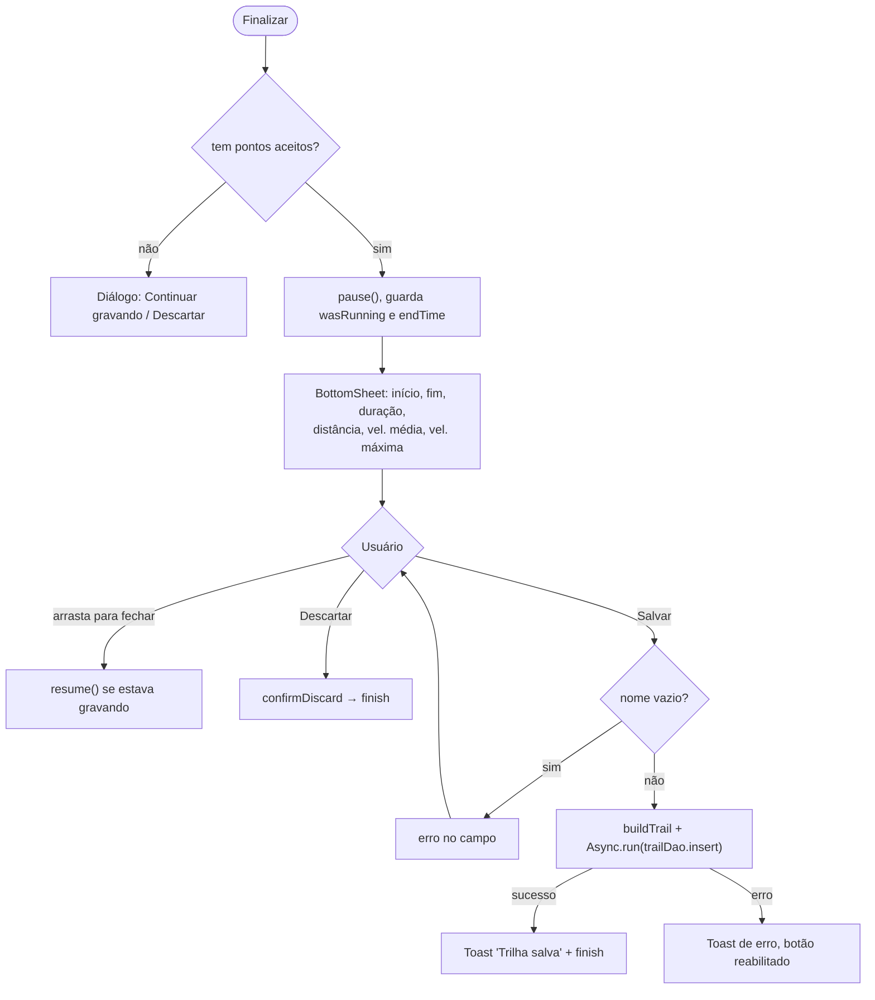
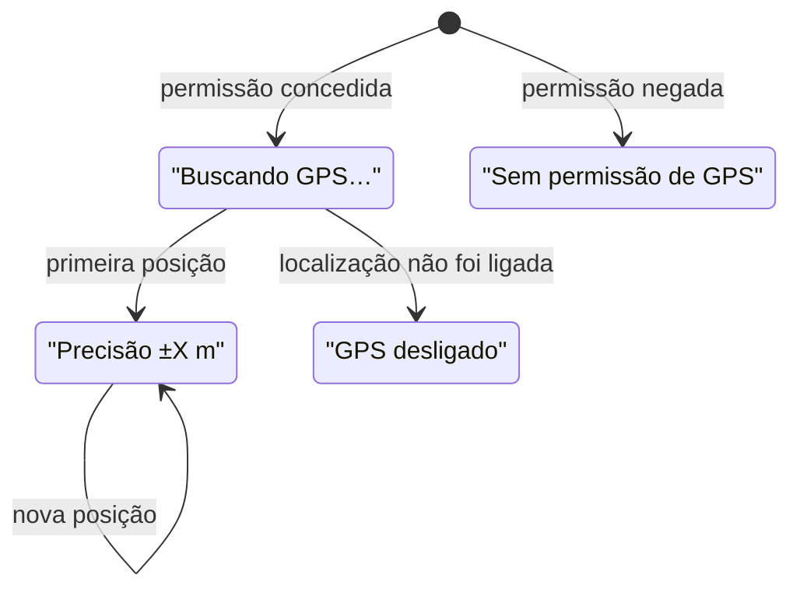

# Tela Registrar Trilha

Documentação da tela de gravação (`RecordTrailActivity`): como ela funciona, o papel de cada classe e método,
e os fluxos completos, do toque em "Registrar trilha" até a trilha salva no banco.

---

## 1. Visão geral

Mapa em tela cheia com controles por cima. A tela:

1. **Mostra o mapa** no tipo escolhido nas Configurações (vetorial ou satélite).
2. **Pede a permissão de localização** e trata a recusa sem quebrar o app.
3. **Verifica se a localização do aparelho está ligada** e oferece ligar com um toque.
4. **Recebe o GPS** só enquanto está visível e desenha a posição com **marcador próprio** e **círculo de acurácia**.
5. **Grava a trilha**: cronômetro com pausa, velocidade instantânea e máxima, distância e pontos aceitos.
6. **Orienta o mapa** em North Up ou Course Up.
7. **Finaliza**: resumo, nome, e salva trilha + pontos no SQLite em uma transação.

### Arquivos envolvidos

| Arquivo | Papel |
|---|---|
| `activities/RecordTrailActivity.java` | Interface: mapa, permissão, ciclo de vida, botões, resumo e salvamento |
| `activities/RecordTrailViewModel.java` | Guarda o `TrailRecorder` durante a rotação de tela |
| `location/LocationTracker.java` | GPS (`FusedLocationProviderClient`): liga, desliga e entrega posições |
| `location/TrailRecorder.java` | Estado da gravação: tempo com pausa, velocidades, distância e pontos |
| `database/TrailDao.java` | `insert(trail)` em transação |
| `util/Formatters.java` | m/s → km/h, m → km, ms → hh:mm:ss, datas |
| `util/MapIcons.java` | Converte o vetor do marcador em `BitmapDescriptor` |
| `util/Async.java` | Executa o insert fora da UI thread |
| `res/layout/activity_record_trail.xml` | Mapa + camada de controles (`record_overlay`) |
| `res/layout/bottom_sheet_finish_trail.xml` | Resumo e campo de nome ao finalizar |

### Quem faz o quê

A Activity **não calcula nada**: ela repassa cada posição para o `TrailRecorder` e só desenha o resultado.
O `TrailRecorder` não conhece View, por isso dá para testá-lo isolado (`TrailRecorderTest`).

---

## 2. Abertura da tela: mapa, permissão e GPS

- O resultado da permissão chega **antes** do `onResume`; por isso `onLocationPermissionGranted` só marca a flag
  e quem liga o GPS é sempre o `onResume`.
- **Recusa permanente**: depois da 2ª recusa, `shouldShowRequestPermissionRationale` devolve `false` e o sistema não
  mostra mais o diálogo dele; o único caminho é a tela de configurações do app.

---

## 3. Uma posição chegando

- **A gravação começa na primeira posição**, para que a hora de início e o primeiro ponto coincidam.
  Até lá o selo mostra "Aguardando GPS" e o Pausar fica desabilitado.
- **Marcador e círculo são criados uma única vez** e depois só atualizados; criar um por leitura deixaria um rastro
  e gastaria memória.
- **Marcador `flat(true)`**: a rotação passa a ser relativa ao norte, então a seta aponta o rumo real mesmo quando o
  mapa gira (Course Up). Parado, o GPS não tem rumo (`hasBearing() == false`) e a seta mantém o último.

---

## 4. Os cálculos (`TrailRecorder.addLocation`)

| Regra | Por quê |
|---|---|
| **Precisão > 25 m é descartada** | Leituras ruins geram picos de velocidade e "saltos" de distância |
| **Só conta depois de andar mais que a própria margem de erro (mín. 5 m)** | Parado, o GPS "passeia" alguns metros a cada leitura; sem esse filtro a distância subiria sozinha |
| **`distanceTo`** | Distância geodésica entre dois pontos (considera a curvatura da Terra) |
| **Ao retomar, `lastAccepted = null`** | O que o usuário andou durante a pausa não entra na distância |
| **Velocidade média = distância ÷ tempo em movimento** | Pausas não puxam a média para baixo |
| **Tempo com `SystemClock.elapsedRealtime()`** | Só anda para frente, mesmo se o usuário mudar o relógio do celular |

### Cronômetro e pausa

- `TrailRecorder` guarda `accumulatedMillis` (trechos já encerrados) e `runningSince` (início do trecho atual).
  Tempo = acumulado + (agora − runningSince) se estiver gravando.
- Um `Handler` atualiza o texto a cada 500 ms **só enquanto a tela está visível** (`onResume`/`onPause`).
- O cronômetro mostra o **tempo em movimento**. A **duração salva** é `fim − início` (o que a lista e a
  visualização mostram).

---

## 5. North Up / Course Up

| Modo | Câmera |
|---|---|
| **North Up** | bearing sempre 0: o norte fica para cima |
| **Course Up** | bearing = rumo do GPS, só quando a velocidade ≥ 0,5 m/s (parado, o rumo é ruído) |

- Os gestos de rotação com dois dedos ficam **desligados**: a orientação vem da configuração.
- O ícone da bússola gira ao contrário do mapa (`setOnCameraMoveListener`), apontando sempre para o norte real.
  Tocar nele volta o mapa para o norte.

---

## 6. Ciclo de vida

- **GPS só com a tela visível**: bateria e privacidade. Se o usuário trocar de app no meio da gravação, o trecho
  fica sem pontos (gravar em segundo plano exigiria um *Foreground Service*).
- **Rotação**: o Android recria a Activity, mas entrega o **mesmo `RecordTrailViewModel`**; tempo, distância e
  pontos continuam. Marcador, círculo e câmera são recriados na próxima posição.

---

## 7. Finalizar e salvar

- **Transação**: `TrailDao.insert` faz `beginTransaction` → insere a trilha → pega o id → insere cada ponto com esse
  `trail_id` → `setTransactionSuccessful` → `endTransaction` (no `finally`). Se qualquer insert falhar
  (`insertOrThrow`), nada é salvo. Inserir dentro de uma transação também é muito mais rápido: o SQLite grava no disco
  uma vez, no commit.
- **Fora da UI thread** (`Async`): centenas de inserts não travam a tela.
- **Voltar com gravação iniciada** (botão ou gesto) pede confirmação antes de descartar (`OnBackPressedCallback`).

---

## 8. Métodos

### `RecordTrailActivity`

| Grupo | Método | O que faz |
|---|---|---|
| Ciclo de vida | `onCreate` | Infla o layout, pega o `TrailRecorder` do ViewModel, cria o `LocationTracker`, liga botões, mapa e permissão |
| | `onResume` / `onPause` | Liga / desliga o GPS e o timer |
| Gravação | `togglePause` | Pausa ou retoma o `TrailRecorder` |
| | `renderRecordingState` / `setRecordingStatus` | Selo (Aguardando GPS / Gravando / Pausado) e botão Pausar/Retomar |
| | `renderStats` | Velocidade, máxima e distância formatadas |
| | `timerTick` | `Runnable` que atualiza o cronômetro a cada 500 ms |
| Finalizar | `onFinishClicked` | Sem pontos → diálogo; senão pausa e abre o resumo |
| | `showFinishSheet` | Preenche o bottom sheet, valida o nome, liga Descartar/Salvar |
| | `averageSpeed` | distância ÷ tempo em movimento |
| | `buildTrail` / `saveTrail` | Monta o `Trail` com cópia dos pontos e grava via `Async` + `TrailDao` |
| | `confirmDiscard` / `backCallback` | Confirmação antes de perder a gravação |
| Permissão | `checkLocationPermission`, `onLocationPermissionResult`, `onLocationPermissionGranted`, `onLocationPermissionDenied`, `showPermissionRationale`, `openAppSettings`, `hasPermission` | Fluxo da seção 2 |
| GPS | `checkDeviceLocation` / `onDeviceLocationOff` | Localização do aparelho desligada |
| | `onLocation` | Entrada de cada posição (seção 3) |
| Mapa | `setupMap` / `onMapReady` / `toGoogleMapType` | Mapa assíncrono, tipo de mapa, sem controles do Google |
| | `updatePositionMarker` / `updateAccuracyCircle` | Marcador próprio e círculo de acurácia |
| | `followCamera` / `isCourseUp` / `resetBearing` | North Up / Course Up e bússola |
| Interface | `showCurrentSettings` / `setupWindowInsets` | Chip da configuração; controles afastados das barras do sistema |

### `TrailRecorder`

| Método | O que faz |
|---|---|
| `start` / `pause` / `resume` | Controla o tempo; `resume` inicia um novo segmento de distância |
| `isStarted` / `isRunning` | Estado da gravação |
| `addLocation` | Velocidades, filtro de precisão, distância e pontos (seção 4) |
| `getElapsedMillis` | Tempo em movimento |
| `getStartTime` | Data/hora de início (relógio do celular) |
| `getCurrentSpeed` / `getMaxSpeed` / `getDistance` / `getPoints` | Resultados |

### `LocationTracker`

| Membro | O que faz |
|---|---|
| Construtor | `FusedLocationProviderClient`, `LocationRequest` (alta precisão, 2 s, mín. 1 s) e `LocationCallback` |
| `checkLocationSettings` | `Task` que falha (com `ResolvableApiException`) se a localização do aparelho estiver desligada |
| `start` / `stop` | `requestLocationUpdates` / `removeLocationUpdates`, protegidos contra chamada dupla |

---

## 9. Estados do chip de precisão

`Location.getAccuracy()` é o raio (em metros) dentro do qual a posição real está com ~68% de probabilidade.
É o mesmo valor usado como raio do círculo semitransparente.
