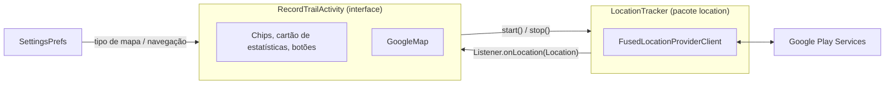
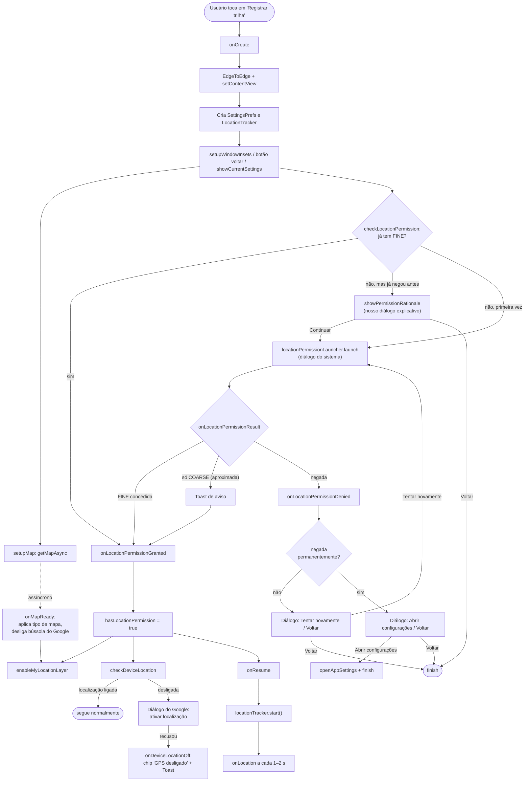
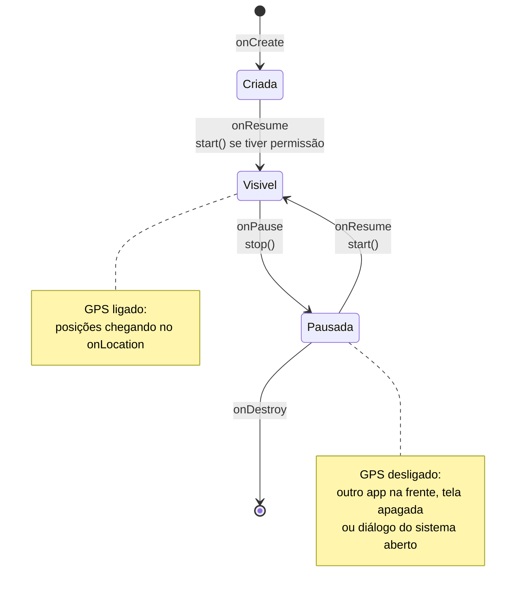
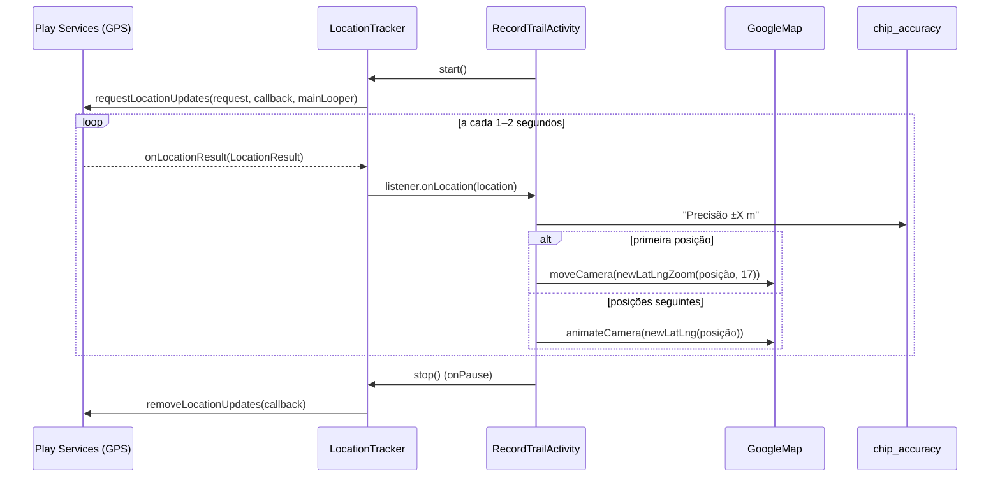
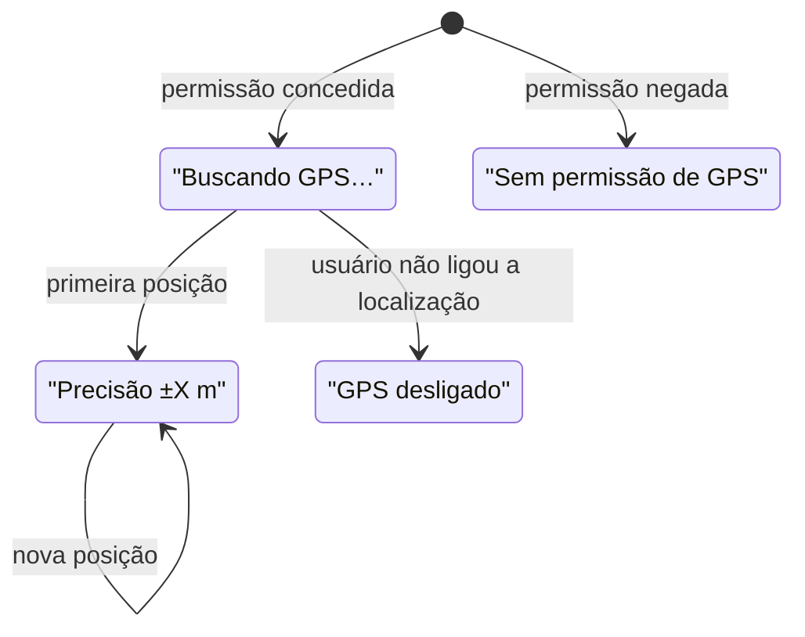

# Tela Registrar Trilha

Documentação da tela de gravação de trilhas (`RecordTrailActivity`) no estado atual do projeto
(issues #17 a #20). Explica como a tela funciona, o papel de cada método e o fluxo completo,
do toque em "Registrar trilha" até a câmera acompanhando o usuário.

> **Ainda não implementado:** marcador personalizado (#21), círculo de acurácia (#22), cronômetro (#23),
> velocidades (#24), distância (#25), North Up / Course Up (#26) e salvar a trilha (#27, #28).
> Esses pontos aparecem marcados como *pendente* nos diagramas.

---

## 1. Visão geral

A tela é um **mapa em tela cheia** com controles flutuando por cima. Ela faz quatro coisas:

1. **Mostra o mapa** no tipo escolhido nas Configurações (vetorial ou satélite).
2. **Pede a permissão de localização** e trata a recusa sem quebrar o app.
3. **Verifica se a localização do aparelho está ligada** e oferece ligar com um toque.
4. **Recebe as posições do GPS** enquanto a tela está visível, move a câmera até o usuário e mostra a precisão.

### Arquivos envolvidos

| Arquivo | Papel |
|---|---|
| `activities/RecordTrailActivity.java` | Controla a tela: mapa, permissão, ciclo de vida e atualização da interface |
| `location/LocationTracker.java` | Encapsula o GPS (`FusedLocationProviderClient`): liga, desliga e entrega posições |
| `util/SettingsPrefs.java` | Lê o tipo de mapa e o modo de navegação salvos |
| `res/layout/activity_record_trail.xml` | Layout: `SupportMapFragment` + camada de controles (`record_overlay`) |

### Divisão de responsabilidades

A Activity **não fala direto com o GPS**: ela só manda o `LocationTracker` ligar ou desligar e recebe as posições
pela interface `Listener`. Assim, a lógica de GPS fica isolada e as próximas issues (velocidade, distância)
podem crescer no pacote `location` sem inchar a Activity.

---

## 2. Fluxo completo da tela

Do `onCreate` até as posições chegando. Os caminhos de permissão negada e GPS desligado também aparecem.

### Por que o GPS só liga no `onResume`?

O resultado da permissão chega **antes** do `onResume` (o diálogo do sistema pausa a Activity e, ao fechar,
ela volta a ficar visível). Então `onLocationPermissionGranted` só marca `hasLocationPermission = true`,
e quem liga o GPS de fato é o `onResume`. Isso garante um único ponto de partida, seja na primeira abertura,
depois de conceder a permissão ou ao voltar de outro app.

---

## 3. Ciclo de vida e o GPS

O GPS **desliga sempre que a tela deixa de estar visível**. Esse é o critério de "pronto" da issue #20
e evita gastar bateria. A consequência é que, se o usuário trocar de app no meio de uma gravação, o percurso
fica com um "buraco" nesse intervalo. Gravar em segundo plano exigiria um *Foreground Service* com notificação
permanente, o que está fora do escopo do trabalho.

`start()` e `stop()` são protegidos contra chamada dupla (campo `running`), então chamar `start()` duas vezes
não cria duas assinaturas no GPS.

---

## 4. Uma posição chegando (sequência)

- A **primeira** posição usa `moveCamera` com zoom 17 (nível de rua): a câmera "pula" da posição padrão
  (meio do Atlântico/África) direto para o usuário, sem animar o mundo inteiro.
- As **seguintes** usam `animateCamera` sem mudar o zoom, então o usuário pode aproximar ou afastar com os dedos
  e a câmera só acompanha o deslocamento.
- O `LocationResult` pode trazer **mais de uma posição** (o sistema às vezes agrupa leituras); o tracker repassa todas,
  em ordem.

---

## 5. Métodos

### `RecordTrailActivity`

#### Campos

| Campo | Para que serve |
|---|---|
| `LOCATION_PERMISSIONS` | FINE + COARSE, pedidas juntas (exigência do Android 12+ para oferecer "aproximada") |
| `INITIAL_ZOOM` | Zoom 17 (rua) aplicado na primeira posição |
| `settingsPrefs` | Leitura do tipo de mapa e do modo de navegação |
| `googleMap` | O mapa; `@Nullable` porque só existe depois do `onMapReady` |
| `chipAccuracy` | Chip "Precisão ±X m" / "Buscando GPS…" / "Sem permissão de GPS" / "GPS desligado" |
| `locationTracker` | Liga/desliga o GPS e entrega as posições |
| `hasLocationPermission` | Se a permissão já foi concedida; o `onResume` consulta antes de ligar o GPS |
| `cameraCentered` | Se a câmera já foi até o usuário (decide entre pular e animar) |
| `locationPermissionLauncher` | Abre o diálogo de permissão do sistema e recebe o resultado |
| `locationSettingsLauncher` | Abre o diálogo do Google para ligar a localização e recebe o resultado |

Os dois *launchers* são campos (e não criados na hora) porque o Android exige registrar
`registerForActivityResult` **antes** de a Activity iniciar.

#### Ciclo de vida

| Método | O que faz |
|---|---|
| `onCreate` | Infla o layout, cria `SettingsPrefs` e `LocationTracker`, configura insets, botão voltar, chip de configuração e mapa, e verifica a permissão |
| `onResume` | Liga o GPS (`locationTracker.start()`) se já tiver permissão |
| `onPause` | Desliga o GPS (`locationTracker.stop()`) |

#### Mapa

| Método | O que faz |
|---|---|
| `setupMap` | Pega o `SupportMapFragment` do layout e chama `getMapAsync(this::onMapReady)` |
| `onMapReady` | Guarda o `GoogleMap`, aplica o tipo de mapa, desliga a bússola e a barra de ferramentas do Google (a tela tem controles próprios) e ativa a camada de localização |
| `toGoogleMapType` | Converte o enum `MapType` para a constante do Google (`MAP_TYPE_NORMAL` / `MAP_TYPE_SATELLITE`). Fica na Activity para o `SettingsPrefs` não depender da biblioteca do Maps |
| `enableMyLocationLayer` | Liga o ponto azul do Google. Só executa quando **o mapa e a permissão** existem, por isso é chamado dos dois lados (`onMapReady` e `onLocationPermissionGranted`). Temporário até o marcador personalizado (#21) |

#### Permissão

| Método | O que faz |
|---|---|
| `hasPermission` | Atalho para `ContextCompat.checkSelfPermission(...) == PERMISSION_GRANTED` |
| `checkLocationPermission` | Já tem FINE → segue. Já negou antes → explica primeiro. Senão → pede |
| `showPermissionRationale` | Diálogo explicando por que o app precisa da localização, com "Continuar" e "Voltar" |
| `onLocationPermissionResult` | Recebe a resposta: FINE → segue; só COARSE → avisa e segue; nenhuma → trata a recusa |
| `onLocationPermissionGranted` | Marca a permissão, atualiza o chip, ativa o ponto azul e verifica se a localização do aparelho está ligada |
| `onLocationPermissionDenied` | Chip "Sem permissão de GPS" e diálogo com "Tentar novamente" ou, se negada permanentemente, "Abrir configurações" |
| `openAppSettings` | Abre a tela de detalhes do app nas configurações do Android e fecha a tela |

**Como o app sabe que a recusa foi permanente?** Depois de uma recusa, `shouldShowRequestPermissionRationale`
devolve `true` (o Android ainda aceita perguntar de novo). Depois da segunda recusa, devolve `false`: o sistema
não mostra mais o diálogo dele, e o único caminho é a tela de configurações do app.

#### GPS e localização do aparelho

| Método | O que faz |
|---|---|
| `checkDeviceLocation` | Chama `locationTracker.checkLocationSettings()`. Se falhar com `ResolvableApiException`, abre o diálogo do Google que liga a localização com um toque |
| `onDeviceLocationOff` | Chip "GPS desligado" e Toast pedindo para ativar a localização |
| `onLocation` | Recebe cada posição: atualiza o chip de precisão e move a câmera |

#### Interface

| Método | O que faz |
|---|---|
| `showCurrentSettings` | Preenche o chip "Mapa vetorial · North Up" a partir do `SettingsPrefs` |
| `setupWindowInsets` | O mapa fica atrás das barras do sistema (edge-to-edge); só a camada de controles recebe padding para não ficar embaixo da barra de status ou de navegação |

### `LocationTracker`

| Membro | O que faz |
|---|---|
| `Listener` | Interface com `onLocation(Location)`; a Activity implementa via `this::onLocation` |
| `UPDATE_INTERVAL_MILLIS` / `FASTEST_INTERVAL_MILLIS` | 2 s de intervalo desejado, 1 s no mínimo |
| Construtor | Cria o `FusedLocationProviderClient`, o `LocationRequest` (alta precisão) e o `LocationCallback` |
| `checkLocationSettings` | Devolve uma `Task` que falha se a localização do aparelho não atende ao pedido |
| `start` | `requestLocationUpdates` no *main looper* (o callback roda na thread da interface) |
| `stop` | `removeLocationUpdates` |

**Por que `PRIORITY_HIGH_ACCURACY`?** Para gravar trilha a pé é preciso o chip de GPS: a localização por Wi-Fi/rede
erra dezenas de metros. O custo é bateria, compensado por desligar o GPS fora da tela.

**Por que `@SuppressLint("MissingPermission")`?** O Lint exige ver um `checkSelfPermission` no mesmo método que pede
a localização. Aqui a verificação acontece antes, na Activity (`hasLocationPermission`), então o aviso é suprimido
de forma consciente.

---

## 6. Estados do chip de precisão

A precisão (`Location.getAccuracy()`) é o raio, em metros, dentro do qual a posição real está com 68% de chance.
É o mesmo valor que vai definir o tamanho do círculo semitransparente na #22.

---

## 7. Perguntas prováveis na defesa

**Por que `getMapAsync` e não pegar o mapa direto?**
O mapa carrega em segundo plano (tiles, estilo). `getMapAsync` avisa pelo callback quando ele está pronto; antes disso
`googleMap` é `null`, por isso o campo é `@Nullable` e os métodos checam antes de usar.

**Por que pedir FINE e COARSE juntas?**
Desde o Android 12, pedir só FINE é rejeitado; o sistema mostra as opções "precisa" e "aproximada" e o app precisa
estar preparado para receber só a aproximada.

**O que acontece se o usuário negar a permissão?**
O app não quebra: o chip mostra "Sem permissão de GPS" e um diálogo oferece tentar de novo (ou abrir as configurações,
se a recusa for permanente) ou voltar ao menu.

**Por que desligar o GPS no `onPause`?**
Economia de bateria e respeito à privacidade: o app só usa a localização enquanto o usuário está vendo a tela.
É o que a issue pede ("o GPS para ao sair da tela").

**Por que um `LocationTracker` separado?**
Separação de responsabilidades: a Activity cuida da interface, o tracker cuida do GPS. Se um dia a gravação for
para um *Service*, basta trocar quem usa o tracker.

**Qual a diferença entre `moveCamera` e `animateCamera`?**
`moveCamera` muda a câmera instantaneamente; `animateCamera` faz a transição suave. A primeira posição usa `moveCamera`
para não animar do outro lado do mundo até o usuário.
