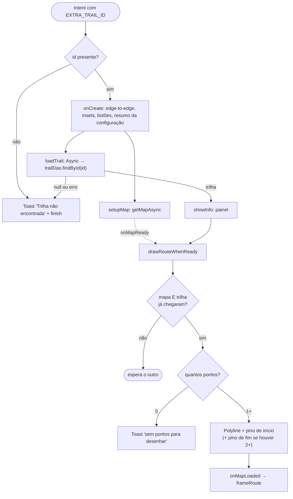
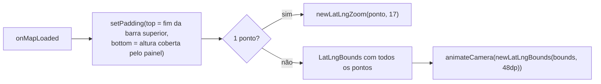

# Tela Visualizar Trilha

A tela `TrailDetailActivity` mostra o percurso de uma trilha no mapa, com pinos de início e fim, a câmera
enquadrando o trajeto inteiro e um painel com as informações. O nome pode ser editado aqui também.

---

## 1. Arquivos envolvidos

| Arquivo | Papel |
|---|---|
| `activities/TrailDetailActivity.java` | Carrega a trilha, desenha o percurso, enquadra e preenche o painel |
| `database/TrailDao.java` | `findById(id)`: trilha + pontos ordenados por `timestamp` |
| `dialog/RenameTrailDialog.java` | Mesmo diálogo da lista |
| `util/MapIcons.java` | Pinos vetoriais → `BitmapDescriptor` |
| `res/layout/activity_trail_detail.xml` | Mapa + barra superior + painel inferior |
| `res/drawable/ic_pin_start.xml` / `ic_pin_end.xml` | Pino verde (play) e pino escuro (bandeira) |

---

## 2. Fluxo

**`drawRouteWhenReady` é chamado dos dois lados** (quando o mapa fica pronto e quando a trilha chega do banco),
porque as duas coisas são assíncronas e chegam em qualquer ordem. Ele só desenha quando as duas existem.

---

## 3. Desenho do percurso

| Elemento | Como |
|---|---|
| **Percurso** | `PolylineOptions` com todos os pontos, `geodesic(true)`; **azul** no mapa vetorial e **amarelo** no satélite (contraste com a imagem escura) |
| **Início** | Marcador com `ic_pin_start` no primeiro ponto |
| **Fim** | Marcador com `ic_pin_end` no último ponto; omitido se a trilha tiver 1 ponto (ficaria em cima do início) |
| **Legenda** | A linha "Percurso" é pintada com a mesma cor do traçado (`setTint` em um `mutate()` do drawable) |

O Google Maps só aceita **bitmap** como ícone de marcador; `MapIcons.fromVector` desenha o vetor num `Bitmap` do
tamanho dele e devolve um `BitmapDescriptor`.

---

## 4. Enquadramento (`frameRoute`)

- **`newLatLngBounds` precisa que o mapa já tenha tamanho**; por isso roda no `setOnMapLoadedCallback`.
- **`setPadding` no mapa** diz ao Google quais áreas estão cobertas pelos cartões: o percurso é enquadrado na parte
  visível entre eles, e o logo do Google sobe para cima do painel.

---

## 5. Painel e renomear

| Campo | Fonte | Formato |
|---|---|---|
| Início | `startTime` | `24/11/2026 · 07:12` |
| Distância | `distance` (m) | `6,21 km` |
| Duração | `endTime − startTime` | `1h 12min` |
| Vel. média | `averageSpeed` (m/s) | `5,2 km/h` |
| Vel. máxima | `maxSpeed` (m/s) | `11,4 km/h` |

O lápis da barra superior abre o `RenameTrailDialog`; ao salvar, o DAO grava em segundo plano e o nome é atualizado
na tela na hora. Ao voltar, a lista recarrega no `onResume` e mostra o novo nome.

---

## 6. Métodos

| Método | O que faz |
|---|---|
| `onCreate` | Valida o id, edge-to-edge, botões, resumo da configuração, mapa e carregamento |
| `setupMap` | Tipo de mapa e sem barra de ferramentas do Google |
| `loadTrail` | `findById` em segundo plano; `null` fecha a tela |
| `showInfo` | Preenche o painel com `Formatters` |
| `showSettingsSummary` | "Mapa vetorial · North Up" e cor da legenda |
| `drawRouteWhenReady` | Polyline e pinos quando mapa e dados existem |
| `routeColorRes` | Azul (vetorial) ou amarelo (satélite) |
| `addPin` | Marcador centralizado com ícone vetorial |
| `frameRoute` | Padding do mapa e câmera enquadrando o percurso |
| `renameTrail` | Diálogo de renomear e atualização na tela |
| `closeWithError` | Toast e `finish` para id inválido ou trilha inexistente |
| `setupWindowInsets` | Controles afastados das barras do sistema; mapa atrás delas |
